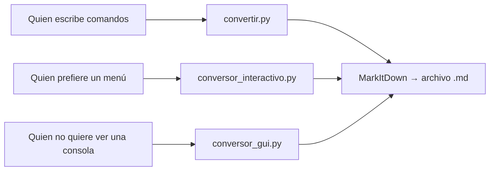

# Proceso

Cómo se hizo, en orden, incluyendo la parte que quedó manual y por qué.

## El contexto

Había carpetas completas de documentos internos en **Word, PDF, PowerPoint y Excel**. El
objetivo no era leerlos ni imprimirlos: era **alimentar un sistema RAG**. Un agente que
responde preguntas consultando esos documentos.

La diferencia importa. Un RAG no "lee" un documento: lo parte en fragmentos, los indexa y
recupera los más parecidos a la pregunta. Si el documento no tiene jerarquía clara ni una
indentación consistente, los fragmentos salen cortados donde no deben y el recuperador
devuelve pedazos sin contexto. La respuesta del agente empeora, y no hay ningún error que
avise.

O sea: la estructura del Markdown no era un detalle de formato. **Era el requisito.**

## Cómo era antes

Documento por documento, a mano:

1. Abrir el documento en su formato original
2. Copiar el contenido a un `.md`
3. Ordenar los encabezados para que respetaran la jerarquía `#`, `##`, `###` sin saltos
4. Ajustar la indentación de las listas para que el parser la leyera igual en todos
5. Revisar que no se hubiera perdido texto en el camino

Entre 25 y 30 minutos por documento. Con una carpeta de decenas de archivos, era un trabajo de
días.

## Qué se automatizó

Un script en Python que recorre una carpeta y convierte todos los documentos, más un archivo
`.bat` que lo lanza con doble clic. La idea del `.bat` era no depender de saber comandos: la
persona que dejaba los documentos solo tenía que copiarlos a una carpeta y ejecutar.

La extracción la resolvía **MarkItDown**, que lee Word, PDF, PowerPoint, Excel e imágenes y
devuelve Markdown. El trabajo propio era el resto: recorrer la carpeta, nombrar la salida,
dejar todos los archivos con la misma forma y revisar que la estructura sirviera.

La salida: un `.md` por documento, listos para el pipeline.

## Tres versiones, tres formas de usarlo

La misma conversión terminó existiendo en tres formatos distintos, no por indecisión sino
porque cada uno servía a una persona distinta:

Entre las tres cubrían PDF, Word, PowerPoint, Excel, imágenes (PNG y JPG), HTML y TXT: todo lo
que había en las carpetas que alimentaban el RAG.

- **`convertir.py`** — recibe los archivos como argumentos. Es la que se encadenaba desde el
  `.bat` para procesar carpetas completas.
- **`conversor_interactivo.py`** — menú de cuatro opciones: convertir un archivo, convertir la
  carpeta completa, listar los archivos disponibles o salir. Confirma antes de procesar el lote
  y al final informa cuántos salieron bien de cuántos.
- **`conversor_gui.py`** — interfaz en Tkinter, con botón de selección, lista de archivos y
  registro de progreso. El botón de convertir está deshabilitado hasta que hay algo
  seleccionado, y **la conversión corre en un hilo aparte** (`threading`) para que la ventana no
  se congele mientras procesa.

La GUI no fue un capricho: nació de una evidencia de formación sobre **interfaz gráfica y mapa
de navegación con criterios de usabilidad y accesibilidad**. El requisito no era "que convierta",
sino "que se pueda usar".

La lección no es "hice tres programas". Es que **el mismo problema tenía tres usuarios con
niveles distintos de comodidad**, y la herramienta se adaptó a cada uno en vez de exigirles
aprender comandos.

**Lo que quedó pendiente:** las tres versiones repiten la lógica de conversión en su interior. El
refactor obvio sería extraer un módulo común y que las tres lo importen. No se hizo entonces, y
queda dicho: es más honesto señalar la deuda que esconderla.

## Qué quedó manual, y por qué

La revisión de la estructura. El script convertía, pero alguien tenía que abrir los resultados
y confirmar que la jerarquía fuera `#`, `##`, `###` sin saltos y que la indentación fuera
consistente.

No era desconfianza hacia el script: es que **un documento de Office no tiene niveles
semánticos**. Tiene estilos visuales, y quien escribió el documento a veces usó "Título 2" solo
porque se veía más grande, no porque el contenido fuera de segundo nivel. La conversión no
puede adivinar esa intención, así que el flujo terminaba con criterio humano.

El reparto real era: la máquina hacía el trabajo mecánico, la persona verificaba la parte que
requiere juicio.

## Qué se volvió automático en esta versión

La revisión de estructura dejó de ser manual: `convertir.py` valida el resultado después de
convertir y avisa de los problemas que antes se buscaban a ojo.

| Revisión | Antes | Ahora |
|---|---|---|
| El primer encabezado es H1 | A ojo | Automático |
| No hay saltos de nivel (`H1` → `H3`) | A ojo | Automático |
| La sangría de las listas es múltiplo de 2 | A ojo | Automático |
| El documento tiene al menos un encabezado | A ojo | Automático |
| El contenido es correcto y no falta texto | A ojo | Sigue siendo manual |

La última fila se queda manual a propósito: verificar que no se perdió información exige
comparar con el original, y eso no lo resuelve una regla.

El PDF es la excepción de esta versión: se **detecta y se informa**, pero no se convierte. Un
PDF no guarda estructura sino posición —dónde está cada palabra en la página—, así que
extraerlo bien exige otro enfoque y otra herramienta. Es mejor decirlo que entregar un
resultado silenciosamente malo.

## Conclusiones

Cosas que aprendí haciendo esto, en orden de importancia:

- **El formato no es cosmético.** Para un RAG, la estructura *es* el contenido. Un documento
  mal jerarquizado se indexa igual, sin errores, y produce respuestas peores. Es una falla
  silenciosa.
- **Automatizar no es sacar a la persona del proceso.** Es moverla al punto donde su criterio
  hace falta. El objetivo nunca fue que el script hiciera todo, sino que dejara de hacer lo
  repetitivo.
- **Lo que no se valida, se rompe sin avisar.** La validación de estructura existe porque el
  error no se ve: el archivo abre bien, se ve bien, y solo falla al consultarlo.

## Lo que este documento no cuenta

Ni los documentos, ni el contenido, ni el pipeline RAG, ni el nombre de la empresa: nada de eso
se puede publicar. Se documenta el proceso y las decisiones, que es lo que sirve para entender
cómo se trabaja.
